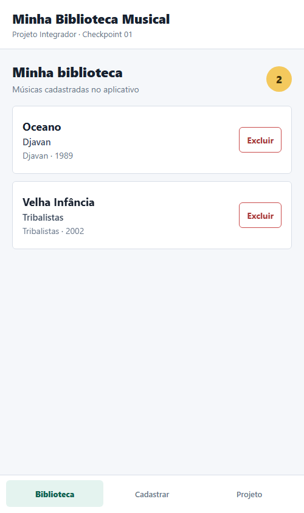
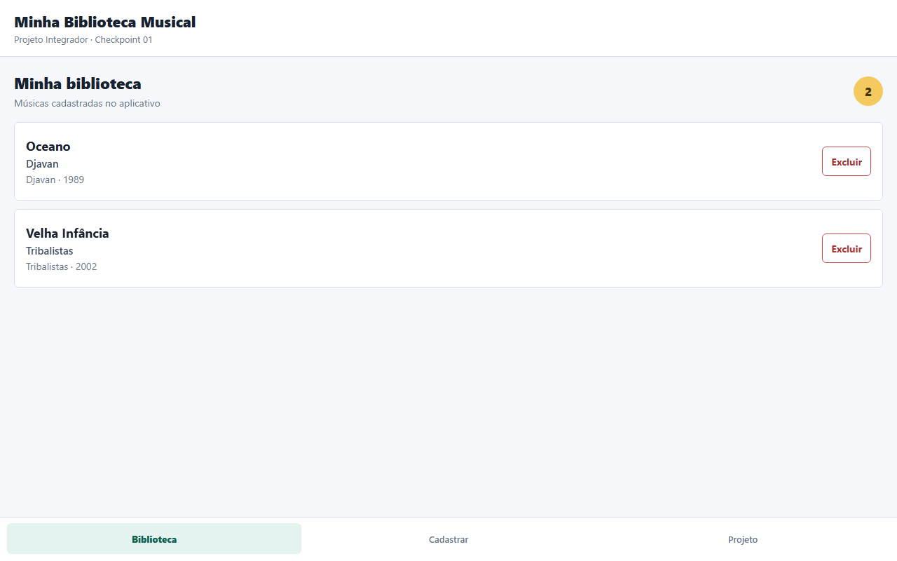

# Documentação do Checkpoint 01

## Identificação

- Aluno: [PREENCHER]
- RM: [PREENCHER]
- Turma: [PREENCHER]
- Disciplina: Projeto Integrador
- Projeto: Minha Biblioteca Musical
- Repositório: [OPCIONAL - INSERIR LINK]

## Nome do projeto

Minha Biblioteca Musical.

## Objetivo da aplicação

O objetivo da aplicação é permitir que o usuário organize uma biblioteca pessoal de músicas. O usuário pode visualizar as músicas cadastradas, adicionar novas músicas com título, artista, álbum e ano de lançamento, e excluir itens da lista.

## Funcionalidades previstas para o projeto completo

- Integração com o backend desenvolvido em Spring Boot.
- Armazenamento das músicas em banco de dados PostgreSQL.
- Cadastro, consulta, edição e exclusão de músicas.
- Busca de músicas por título ou artista.
- Filtros e organização da biblioteca.
- Tratamento de carregamento e erros da API.

## Funcionalidades implementadas no Checkpoint 01

- Tela de biblioteca com listagem das músicas.
- Tela de cadastro de uma nova música.
- Tela com informações sobre o projeto.
- Cadastro local de título, artista, álbum e ano de lançamento.
- Validação dos campos do formulário.
- Exclusão de músicas cadastradas.
- Contador de músicas da biblioteca.
- Navegação simples entre as telas principais.
- Componentes próprios com comunicação por propriedades.
- Gerenciamento de dados e telas com `useState`.
- Estilização e organização da interface com Flexbox.

## Organização do código

O arquivo `App.tsx` controla os estados da aplicação e a renderização das telas. A pasta `src/components` contém os componentes reutilizáveis `Botao`, `CardMusica` e `MenuNavegacao`. A pasta `src/models` contém a interface TypeScript `Musica`.

## Dificuldades encontradas

As principais dificuldades foram organizar os estados do formulário, validar os dados digitados e atualizar a lista de músicas sem alterar diretamente o estado. Também foi necessário organizar os componentes e os estilos para que a interface se adapte ao espaço disponível.

## Tecnologias e conceitos utilizados

- React Native com Expo.
- TypeScript.
- Componentes básicos: `View`, `Text`, `TextInput`, `Pressable`, `FlatList` e `ScrollView`.
- Componentes próprios e propriedades.
- Estado com `useState`.
- `StyleSheet` e Flexbox.

## Capturas de tela

### Tela de biblioteca

### Tela de biblioteca no navegador

As telas de cadastro e de projeto podem ser capturadas pelo aluno no Expo Go antes da entrega, caso o professor solicite imagens adicionais.
